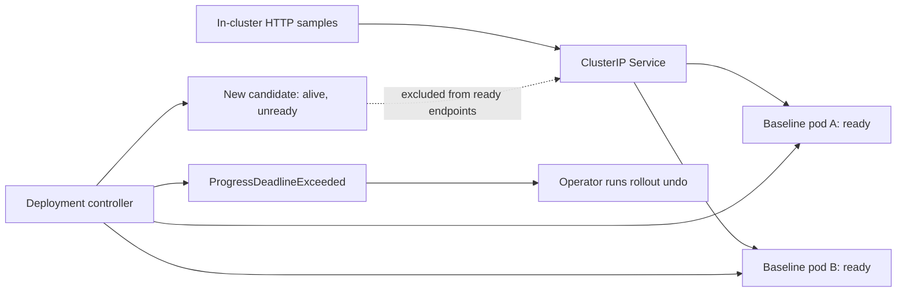

# Kubernetes reliability lab

**A failed release should be detectable, contained, and recoverable.** This Laniakea Consult lab demonstrates a Kubernetes rollout where the new process stays alive but cannot accept traffic. The existing replicas remain available, the deployment reports a progress deadline failure, and an explicit rollback restores the original specification.

The repository contains original demonstration code and synthetic workloads. It is a runnable engineering example, with no production performance or availability claims.



## Run it

Prerequisites: Python 3.9+, Docker running with about 4 GiB free memory, [kind 0.32.0](https://github.com/kubernetes-sigs/kind/releases/tag/v0.32.0) or a compatible newer release, and kubectl 1.36.x. The tested combination is pinned in CI. Expect several minutes plus first-time image downloads.

```bash
python3 -m unittest discover -s tests -v
python3 scripts/lab.py
```

The runner creates a uniquely named `laniakea-reliability-*` kind cluster and a private kubeconfig under `.lab/runs/`. It uses explicit context and namespace arguments for every kubectl call. It deletes its cluster and uniquely tagged app image on completion, including failures, and verifies that the user's kubeconfig files were unchanged.

No cloud account, external registry push, public endpoint, or paid service is needed. The kind node uses privileged Docker access as part of kind's local Kubernetes architecture; the application pods run without root or elevated capabilities. The runner caps the node at 2 CPUs and 2 GiB after cluster startup. The initial startup and image build use Docker's existing resource allocation.

To keep the completed cluster for manual practice:

```bash
python3 scripts/lab.py --keep
# Use the exact run directory printed by the runner:
python3 scripts/lab.py --cleanup .lab/runs/laniakea-reliability-<run-id>
```

## What the exercise checks

| Stage | Expected observation |
|---|---|
| Baseline | Two ready replicas; 10 successful requests through Service DNS and ClusterIP |
| Bad candidate | `READY=false` creates one surge pod; `/livez` returns 200 and `/readyz` returns 503 |
| Stalled rollout | `ProgressDeadlineExceeded`; two baseline replicas remain available; ready EndpointSlice members are unchanged; 10 more successful Service requests |
| Recovery | `kubectl rollout undo` restores the baseline template; candidate is deleted; two ready replicas and 10 successful Service requests |

The candidate is deliberately misconfigured using an environment variable; this is a release configuration regression, not a simulated node failure. Kubernetes reports the failed rollout and does **not** automatically roll it back. The exercise performs that recovery action explicitly. [Kubernetes deployment behavior](https://kubernetes.io/docs/concepts/workloads/controllers/deployment/)

See [the runbook](docs/runbook.md) for commands and diagnostic branches, [architecture decisions](docs/architecture.md) for tradeoffs, and [recorded local evidence](evidence/README.md) for what was actually observed.

## Engineering choices

- Three probe endpoints distinguish initialization, ability to serve traffic, and process responsiveness. Startup gates readiness and liveness checks. [Kubernetes probes](https://kubernetes.io/docs/concepts/workloads/pods/probes/)
- `maxUnavailable: 0`, `maxSurge: 1`, two replicas, and a short progress deadline make the failure visible without intentionally removing a ready baseline replica.
- The namespace enforces the Restricted Pod Security Standard. App pods use UID 10001, drop all capabilities, disable privilege escalation, use `RuntimeDefault` seccomp, have a read-only root filesystem, and receive no service account token. [Pod security standards](https://kubernetes.io/docs/concepts/security/pod-security-standards/)
- Requests of 25m CPU / 32 MiB and limits of 200m CPU / 64 MiB keep the demonstration small. These values are lab settings, not sizing recommendations.
- The app uses only Python's standard library. Manifests are JSON, which Kubernetes accepts directly; `kustomization.yaml` can compose them without a Python YAML dependency.
- GitHub Actions runs unit/manifest checks, server-side validation on kind, and the full recovery exercise. Actions, tool downloads, and container base images are pinned. No deployment credentials or write-scoped repository token are needed.

## Boundaries

This single-node lab does not establish high availability across nodes or zones. Thirty requests sampled across three phases do not prove continuous zero downtime, an SLO, or load capacity. It does not exercise a real external dependency, data migrations, ingress/TLS, authentication, network policy enforcement, autoscaling, node eviction, backups, or production observability. The Python demonstration HTTP server is unsuitable as an internet-facing production application.

`rollout undo` restores the pod template; it does not reverse database migrations or changes to externally managed configuration. Production adoption needs those recovery decisions, representative load tests, traffic-drain validation, monitoring, and environment-specific resource sizing.

## Work with Laniakea

If your team needs a clear release health gate, a usable rollback runbook, or help diagnosing Kubernetes rollout failures, [discuss a DevOps engagement](https://laniakeaconsult.com/contact?service=devops) or email [nayab@laniakeaconsult.com](mailto:nayab@laniakeaconsult.com).

[MIT license](LICENSE) applies to the original code in this repository. Upstream tools and images retain their own licenses.
